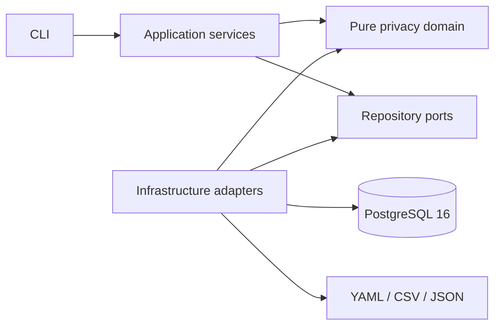

# Relational Data Privacy Governance

[](https://github.com/samueldvi/relational-data-privacy-governance/actions/workflows/ci.yml)

Relational Data Privacy Governance is a validated B2B proof of concept for discovering, classifying, and protecting personally identifiable information across interconnected PostgreSQL databases without breaking the relationships needed by development, testing, and analytics teams.

It is designed for technical evaluation by enterprise data teams, consulting firms, platform architects, security stakeholders, and privacy engineering functions. The current release demonstrates a complete local workflow on synthetic CRM, HR, and Billing data. It is not presented as a deployed enterprise product, a managed service, or evidence of regulatory compliance.

## Business value

Organizations frequently need representative relational datasets outside production. Conventional field-by-field masking can break joins, unique constraints, and cross-system identity consistency. Copying production data unchanged creates unnecessary exposure. This proof of concept demonstrates a policy-driven middle path:

- inventory database structure and relationships;
- combine metadata and value-pattern evidence to classify PII;
- apply deterministic, namespace-scoped pseudonymization;
- preserve approved relational and analytical behavior;
- validate protected outputs before commit;
- produce aggregate audit evidence without exporting source PII or mappings.

## Verified reference implementation

The figures below were reproduced locally on 2026-10-08 at Git revision `6b199e1` using Python 3.12.10 and PostgreSQL 16. Commands and environmental constraints are recorded in [testing and validation](docs/testing_and_validation.md).

| Evidence | Verified result |
|---|---:|
| Source schemas | 3 (`crm`, `hr`, `billing`) |
| Source / protected tables | 20 / 20 |
| Inventoried and classified columns | 109 |
| Synthetic source / protected rows | 2,063 / 2,063 |
| Masking rules | 12 |
| Cross-table consistency groups | 9 |
| Automated tests | 182 passed |
| Branch-aware coverage | 88.3% |
| Schema drift | 0 findings |
| Deterministic idempotence | verified |

These results establish the behavior of the synthetic reference workload only. They do not establish performance, detection accuracy, security, or compliance on an organization's real data.

## Architecture



The solution is a modular monolith. A single deployment retains a clear transaction boundary for protected-schema replacement while domain, application, presentation, and infrastructure concerns remain separated and contract-tested. The authoritative flow is:

```text
generate → inventory → profile → classify → mask → validate
```

See [architecture](docs/ARCHITECTURE.md) and the [technical white paper](docs/technical_whitepaper.md) for the rationale and trust boundaries.

## Privacy transformation model

The implementation uses versioned YAML policy for data domains, the PII registry, masking rules, cross-table consistency groups, ambiguous-field decisions, and schema baseline.

- Direct identifiers use HMAC-SHA-256 with an external secret, explicit normalization, and namespace separation.
- Format-aware rules generate formally valid synthetic Italian tax codes and non-routable Italian IBANs.
- Approved technical keys remain unchanged to preserve primary and foreign key relationships.
- Date shifting, address replacement, conditional contact masking, and multi-pattern free-text redaction cover additional domains.
- Mappings exist only in memory during a batch and are not persisted.
- Ambiguous non-null data blocks execution unless an explicit reviewed strategy exists.

This is pseudonymization, not anonymization. Equality is intentionally retained inside approved consistency groups, and key compromise or auxiliary data may enable linkage.

## Quick start

Prerequisites: Python 3.12, Docker with Compose, and a POSIX shell.

```bash
cp .env.example .env
# Replace all placeholders with local-only values.
python3.12 -m venv .venv
source .venv/bin/activate
python -m pip install --requirement requirements-dev.txt
docker compose up -d --wait postgres
python -m src.cli all
```

PostgreSQL initialization scripts run automatically only when the Compose data volume is new. The repository never resets the volume implicitly. For a controlled clean-room validation, use `scripts/validate_clean_environment.sh` after reviewing its explicit cleanup behavior.

If the default host port is occupied, use the same override for Compose and each local command:

```bash
POSTGRES_PORT=55433 docker compose up -d --wait postgres
POSTGRES_PORT=55433 python -m src.cli all
```

## Command-line interface

| Command | Purpose |
|---|---|
| `python -m src.cli status` | Report aggregate database, registry, manifest, and Git status |
| `python -m src.cli generate --seed 20260804` | Generate the deterministic synthetic workload |
| `python -m src.cli inventory` | Export structural inventory and approved relationships |
| `python -m src.cli profile` | Produce aggregate profiling with redacted samples |
| `python -m src.cli classify` | Build the YAML registry, catalog, and classification report |
| `python -m src.cli mask --dry-run` | Validate preconditions and show a no-write execution plan |
| `python -m src.cli mask` | Create and load protected schemas transactionally |
| `python -m src.cli mask --validate-only` | Validate the existing protected database without writes |
| `python -m src.cli validate` | Run integrated validation against the manifest |
| `python -m src.cli validate --check-idempotence` | Repeat the load and compare deterministic results |
| `python -m src.cli drift --check` | Fail on structural or governance drift |
| `python -m src.cli drift --write-baseline` | Explicitly update the reviewed baseline |
| `python -m src.cli all` | Run the complete fail-fast workflow |

Commands return non-zero on controlled failure. Normal output contains aggregate counts, status, duration, validation results, and checksums—not credentials, source records, pseudonyms, or mapping tables.

## Container execution

The application image uses Python 3.12 slim with a pinned digest, installs runtime dependencies only, runs as UID/GID `10001`, and uses a read-only root filesystem. Writable locations are limited to temporary and generated-output volumes.

```bash
docker compose build privacy-pipeline
docker compose run --rm privacy-pipeline python -m src.cli status
docker compose run --rm privacy-pipeline python -m src.cli all
```

## Verification

```bash
python -m src.cli all
python -m src.cli drift --check
python -m src.cli validate --check-idempotence
python -m coverage run -m pytest -q
python -m coverage report
python -m mypy src
python -m ruff check .
python -m ruff format --check .
python -m pip_audit
python scripts/check_repository_safety.py
git diff --check
```

Database-dependent tests run against PostgreSQL; they are not mocked or silently skipped. See [testing and validation](docs/testing_and_validation.md) for the evidence boundary.

## Security and governance boundaries

- The bundled dataset is synthetic and uses reserved test domains and deliberately non-routable formats.
- `.env` and generated outputs are excluded from version control.
- Database values are parameterized and dynamic identifiers use `psycopg.sql.Identifier`.
- Protected-schema loading is transactional and validates target names, constraints, relationships, row counts, source invariants, and canonical checksums.
- Free-text redaction is pattern-based and can miss unknown sensitive structures.
- Secrets are supplied through environment variables; there is no production key-management integration or rotation service.
- The current Compose topology uses one database role and does not implement enterprise authentication, authorization, tenant isolation, or audit-log transport.
- No direct Informatica Data Privacy Management integration is included. Existing material describes conceptual portability only.

Review [SECURITY.md](SECURITY.md), the [technical audit](docs/technical_audit.md), and the [commercial readiness assessment](docs/commercial_readiness.md) before any pilot evaluation.

## Product maturity

The repository is suitable for a controlled technical proof-of-concept evaluation using synthetic or explicitly approved non-production data. It is not yet suitable for production workloads or unsupervised processing of real personal data.

Major gaps before a controlled customer pilot include authenticated access, role-based authorization, managed secrets, immutable operational audit logs, deployment packaging, monitoring and alerting, backup/recovery procedures, licensing decisions, support ownership, and validation on representative authorized datasets. The prioritized path from proof of concept to pilot and enterprise product is documented in [commercial readiness](docs/commercial_readiness.md).

## Documentation

- [Technical white paper](docs/technical_whitepaper.md)
- [Architecture](docs/ARCHITECTURE.md)
- [Data governance workflow](docs/data_governance_workflow.md)
- [Testing and validation](docs/testing_and_validation.md)
- [Technical audit](docs/technical_audit.md)
- [Commercial readiness and roadmap](docs/commercial_readiness.md)
- [Limitations and future work](docs/limitations_and_future_work.md)
- [Masking rules](docs/REGOLE_MASCHERAMENTO.md)
- [Decision log](docs/DECISION_LOG.md)

## Repository structure

```text
.
├── .github/workflows/       # CI, dependency, code, and container checks
├── config/                  # Domains, registry, rules, consistency groups, baseline
├── docs/                    # Product, architecture, governance, and validation documentation
├── scripts/                 # Clean validation and repository-safety controls
├── sql/                     # Ordered PostgreSQL initialization
├── src/                     # CLI, application, domain, ports, and infrastructure
├── tests/                   # Unit, contract, integration, container, and security tests
├── compose.yml
├── Dockerfile
└── requirements*.txt
```

## Scope statement

This repository provides a technical reference implementation and evidence package for evaluating relational privacy-governance controls. Productization, legal qualification, organizational process, and environment-specific risk acceptance remain the responsibility of the adopting organization.
