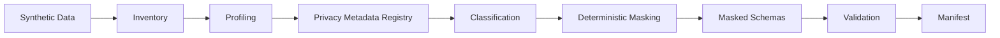

# Relational Data Privacy Governance

[](https://github.com/samueldvi/relational-data-privacy-governance/actions/workflows/ci.yml)

## TL;DR

Pipeline locale Python 3.12 e PostgreSQL 16 per generare dati sintetici, inventariare e classificare PII e creare copie masked relazionalmente coerenti.
Il risultato comprende 20 tabelle sorgente e 20 masked, governate da un registry completo di 109 colonne.
HMAC-SHA-256 namespaced, caricamento transazionale, rollback, idempotenza e checksum deterministici rendono il processo verificabile.
Il repository prepara concetti e controlli trasferibili verso Informatica Data Privacy Management, senza dichiarare un'integrazione diretta con la piattaforma.

## Risultati verificabili

| Evidenza | Risultato |
|---|---:|
| Schemi sorgente | 3 (`crm`, `hr`, `billing`) |
| Tabelle sorgente / masked | 20 / 20 |
| Colonne inventariate e classificate | 109 |
| Righe sintetiche sorgente / masked | 2.063 / 2.063 |
| Regole di masking | 12 |
| Consistency group | 9 |
| Test automatici | 108 superati prima della finalizzazione documentale |
| Manifest | checksum per tabella e globale, deterministici |

La suite verifica inoltre rollback completo, idempotenza con lo stesso secret,
output differenti con secret differenti, invarianti delle sorgenti, constraint,
relazioni dichiarate e logiche e assenza di PII rilevabile dalle regole note.

## Architettura



La CLI orchestra i moduli esistenti senza duplicarne la logica. Le dipendenze
fra tabelle sono ricavate dai metadati PostgreSQL; le due relazioni puramente
logiche restano prive di foreign key anche negli schemi masked.

## Quick start

Prerequisiti: Docker con Compose, Python 3.12 e una shell POSIX. Dalla root:

```bash
cp .env.example .env
# Sostituire in .env i placeholder con valori locali non riutilizzati altrove.
python -m venv .venv
source .venv/bin/activate
python -m pip install -r requirements.txt
docker compose up -d
python -m src.cli all
```

Il container inizializza gli script `sql/00_...`–`sql/05_...` solo alla prima
creazione del volume. Per una validazione controllata da ambiente pulito usare
lo script documentato in `scripts/validate_clean_environment.sh`; il reset non
è mai implicito.

## CLI

| Comando | Funzione |
|---|---|
| `python -m src.cli status` | Stato aggregato di database, registry, manifest e branch |
| `python -m src.cli generate --seed 20260804` | Generazione deterministica delle 2.063 righe sintetiche |
| `python -m src.cli inventory` | Inventario e relazioni in `output/*.csv` |
| `python -m src.cli profile` | Profiling aggregato e campioni redatti |
| `python -m src.cli classify` | Registry YAML, catalogo CSV e classificazione Markdown |
| `python -m src.cli mask --dry-run` | Precondizioni e piano senza scritture |
| `python -m src.cli mask` | Creazione e caricamento transazionale degli schemi masked |
| `python -m src.cli mask --validate-only` | Controllo read-only dello stato masked |
| `python -m src.cli validate` | Validazione integrata e confronto col manifest |
| `python -m src.cli validate --check-idempotence` | Due esecuzioni equivalenti e confronto deterministico |
| `python -m src.cli all` | Pipeline completa, interrotta al primo errore |

Ogni comando restituisce un exit code non nullo in caso di errore e stampa solo
conteggi, stati, durate, statistiche e checksum. Non stampa credenziali,
mapping, pseudonimi o record completi.

## Componenti e output

- `src/generate_data.py`: dataset sintetico riproducibile con seed esplicito;
- `src/inventory.py`: 109 colonne, constraint e relazioni logiche;
- `src/profile_columns.py`: pattern, normalizzazioni e confronti cross-tabella;
- `src/classify.py`: classificazione completa e override di governance;
- `src/masking.py`: primitive HMAC-SHA-256 e collision resolver batch;
- `src/apply_masking.py`: DDL, caricamento e validazione in una transazione;
- `src/masking_manifest.py`: canonicalizzazione e checksum;
- `src/cli.py`: orchestrazione end-to-end e stato operativo.

Gli artefatti rigenerabili sono salvati in `output/` e ignorati da Git. Il
manifest contiene metadati aggregati, statistiche di collisione, controlli e
checksum, mai valori o mapping.

## Sicurezza e governance

- Il dataset è interamente sintetico e usa domini e numerazioni riservati ai test.
- `.env` è escluso da Git; segreto di masking e password restano esterni al codice.
- Le pseudonimizzazioni usano HMAC-SHA-256 con namespace separati per dominio e soggetto.
- I mapping vivono solo in memoria durante il batch e non vengono persistiti.
- Campioni di profiling e testi liberi sono redatti prima della scrittura degli output.
- Gli schemi sorgente sono verificati prima e dopo il masking e restano immutati.
- `billing.pagamenti.riferimento_bancario` resta `Dubbio`: D-008 autorizza solo
  `redact_detected_patterns`, con rischio residuo esplicitamente accettato.

Il repository è un ambiente didattico e dimostrativo. Non deve elaborare dati
reali senza threat model, gestione professionale delle chiavi, controlli IAM,
valutazione legale, monitoraggio e revisione del data owner.

## Limiti

- La discovery è regex e contestuale; non include Named Entity Recognition.
- Codici fiscali e IBAN sono formalmente validi, non verificati anagraficamente o bancariamente.
- Le prestazioni sono validate sul volume locale di 2.063 righe, non su scala enterprise.
- Il riferimento bancario eterogeneo può contenere valori sensibili non riconosciuti dalle regex.
- Non è disponibile un processo di re-identificazione: il mapping non viene conservato.
- Funzioni, nomi, licenze e capacità di Informatica devono essere verificati su un ambiente autorizzato.

## Trasferimento verso Informatica

Il progetto implementa localmente inventory, profiling, data domain, policy,
consistent masking, target masked, validazioni e audit tecnico. Questi concetti
costituiscono una base di analisi, non la prova che il repository utilizzi
Informatica direttamente. Il mapping, le verifiche di piattaforma e il piano di
adozione sono descritti in
[`docs/TRASFERIMENTO_INFORMATICA.md`](docs/TRASFERIMENTO_INFORMATICA.md).

## Demo web

Non è inclusa una web app. La valutazione in
[`docs/WEB_DEMO_FEASIBILITY.md`](docs/WEB_DEMO_FEASIBILITY.md) raccomanda una
demo statica alimentata esclusivamente da JSON aggregati e revisionati, senza
connessione al database o esecuzione del masking.

## Struttura del repository

```text
.
├── .github/workflows/       # CI PostgreSQL end-to-end
├── config/                  # domini, registry, regole, gruppi e decisioni operative
├── docs/                    # classificazione, decision log e documentazione tecnica
├── scripts/                 # validazione pulita e controlli di sicurezza
├── sql/                     # inizializzazione PostgreSQL ordinata
├── src/                     # pipeline e CLI Python
├── tests/                   # test unitari, integrazione, CLI, CI e sicurezza
├── compose.yml
├── requirements.txt
└── README.md
```

## Verifica locale

```bash
python -m src.cli status
python -m src.cli all
pytest -q
python scripts/check_repository_safety.py
git diff --check
```

Le decisioni effettivamente approvate sono versionate in
[`docs/DECISION_LOG.md`](docs/DECISION_LOG.md); le regole sono descritte in
[`docs/REGOLE_MASCHERAMENTO.md`](docs/REGOLE_MASCHERAMENTO.md).
