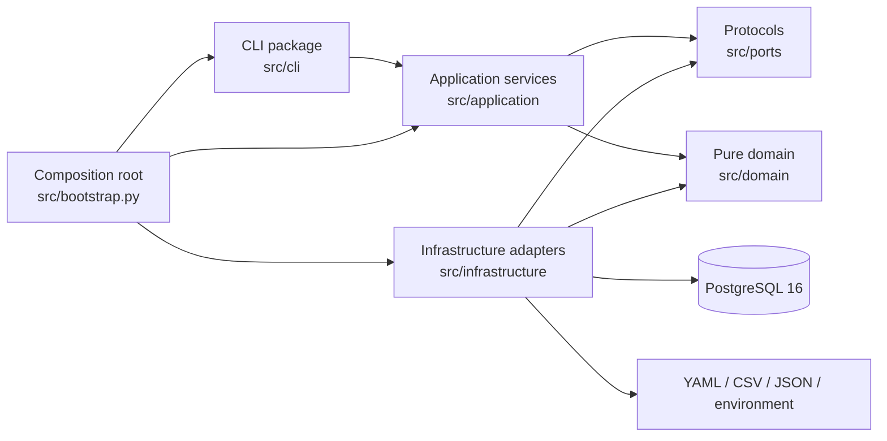
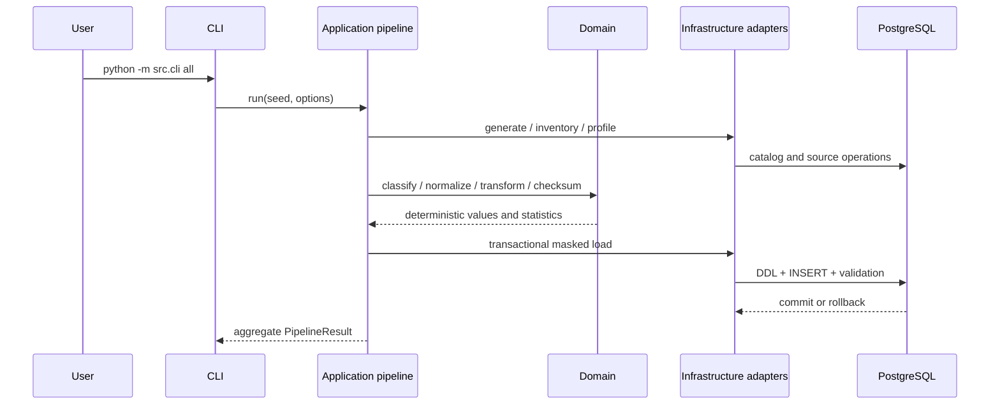

# Modular monolith architecture

## Context and goals

The repository executes one privacy-governance pipeline over a local PostgreSQL instance. The previous implementation was intentionally script-oriented: CLI parsing, orchestration, pure privacy rules, configuration and database access were close together in top-level modules. That made the validated behavior easy to run but made dependencies difficult to substitute and unit tests unnecessarily coupled to PostgreSQL.

The current design is a modular monolith. One deployable Python project retains the transactional guarantees and operational simplicity of the original implementation while enforcing boundaries between presentation, orchestration, domain policy and adapters.

## Modules and dependency rules

- `src/domain` owns stable types, identifier validation, normalizers, HMAC transformations, collision handling, redaction and canonical checksums. It imports no PostgreSQL, CLI, YAML or environment adapter.
- `src/ports` defines protocols for metadata/source/masked repositories, configuration, registry, manifest, secrets and time.
- `src/application` owns use-case services and the single authoritative phase order in `application/pipeline.py`. It depends on domain concepts and injected callables, not concrete infrastructure.
- `src/infrastructure` owns PostgreSQL connectivity and repository adapters, configuration loading, serialization, environment secrets, system time and project status reads.
- `src/cli` is a presentation boundary. Command handlers accept an `ApplicationContext`, print aggregate-safe results and do not query PostgreSQL.
- `src/bootstrap.py` is the composition root. It is the only place where application services are wired to concrete local adapters and transitional entry points.

## Data flow

The complete order is `generate → inventory → profile → classify → mask → validate`; it is defined only by `PIPELINE_PHASES` and `EndToEndPipeline`.

## Transactions and determinism

`apply_masking.py` remains a compatibility entry point around the validated transactional loader while PostgreSQL concerns are progressively represented by the repository ports. The loader owns one transaction for controlled schema replacement, DDL, inserts and post-load validation. An exception before completion causes rollback; no domain transformation opens or commits a connection.

Pseudonyms use HMAC-SHA-256 with explicit secret, namespace and normalized input. Collision resolution is deterministic and keeps mappings in memory. Canonical table payloads preserve value types before SHA-256 checksums. The Git commit is manifest metadata, so a global manifest checksum may change between commits; unchanged table checksums prove masked data did not change.

## Configuration and security

The central loader in `infrastructure/config/loader.py` is the YAML boundary. Typed settings in `infrastructure/config/settings.py` validate database environment input. `EnvironmentSecretProvider` is injected at the compatibility/composition boundary; the domain receives secret material explicitly and never reads the environment.

Normal CLI failures suppress tracebacks and unknown exception text. Logs and command output contain aggregate counts, statuses, durations and checksums only. Secrets, DSNs, source rows, free text, pseudonyms and mapping tables are excluded. Repository safety checks and CI filename checks guard tracked artifacts.

The confirmed decision for `billing.pagamenti.riferimento_bancario` remains `redact_detected_patterns`. It covers known tax-code, IBAN, email, phone, partial-card and recognizable bank-reference patterns. Residual risk remains explicit: sensitive values outside known regular expressions can survive redaction.

## Test strategy

- `tests/unit/domain` checks stable models and side-effect-free privacy primitives without PostgreSQL.
- `tests/unit/application` checks service delegation, pipeline order and fail-fast behavior.
- existing database tests remain integration coverage for 20 source and 20 masked tables, 2,063 rows on each side, constraints, rollback, idempotence and PII detection.
- `tests/contract/test_architecture.py` parses imports with the standard-library AST, verifies dependency rules, checks all public CLI commands and rejects hardcoded virtualenv interpreters.
- CI uses Python 3.12 and PostgreSQL 16, executes the end-to-end pipeline, architecture contracts, the full suite and safety checks in the single `tests` job.

## Decisions and trade-offs

Microservices were rejected because the phases share one database lifecycle, one transaction boundary and one local governance context. Splitting deployment units would add failure modes and distributed coordination without an independent scaling or ownership need. Dependency inversion supplies testability without that operational cost.

Top-level modules such as `masking.py`, `masking_manifest.py` and `db.py` remain compatibility facades so existing imports and documented commands do not break. Pure implementations have moved to the domain; the facades contain adapter or documentation concerns only. Larger legacy workflow entry points (`inventory.py`, `profile_columns.py`, `classify.py`, `apply_masking.py`) are currently wired behind application services. Their replacement by the already-defined repository ports can proceed incrementally without changing the public CLI or data representation.

## Limits and future extensions

- Regex discovery does not provide named-entity recognition and cannot guarantee detection of every sensitive free-text value.
- The current volume validates correctness, not enterprise throughput.
- Production use requires managed key storage, IAM, audit transport, monitoring, legal review and data-owner approval.
- Future work can replace each compatibility workflow callable with a native service implementation over `src/ports`, then remove the corresponding facade after parity tests prove identical table checksums.

## Product evaluation summary

The architecture preserves one transaction boundary while separating presentation, orchestration, pure policy and infrastructure. Source schemas are `crm`, `hr` and `billing`; protected targets are `masked_crm`, `masked_hr` and `masked_billing`. Technical keys remain unchanged under registry authorization so relationships survive, while direct identifiers use rules and namespace-scoped consistency groups. Checksums prove repeatability, not confidentiality. The current implementation is a validated B2B proof of concept; real-data operation, production IAM, managed keys, operational controls, and legal compliance remain outside its verified scope.
