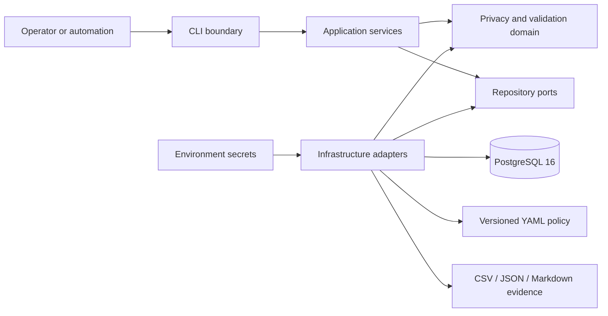

# Relational Data Privacy Governance

## Technical white paper for controlled B2B evaluation

**Document status:** proof-of-concept reference architecture

**Validation baseline:** 2026-10-08, Git revision `6b199e1`

**Intended audience:** enterprise data architects, privacy engineers, security teams, data platform owners, consulting firms, and technical procurement evaluators

## Executive summary

Organizations need production-like relational data for application development, quality assurance, analytics, migration rehearsal, and vendor delivery. Copying operational databases into lower environments can expose personal data. Masking each column independently can remove direct identifiers but destroy primary/foreign-key relationships, cross-table equality, unique constraints, and analytical usefulness.

Relational Data Privacy Governance is a validated technical proof of concept that demonstrates a policy-driven alternative. It inventories PostgreSQL schemas, profiles values without exporting unredacted samples, classifies PII using deterministic evidence, applies namespace-scoped pseudonymization and masking, reconstructs protected schemas transactionally, and validates the resulting relational system before commit.

The reference workload covers three synthetic domains—CRM, HR, and Billing—and has reproducibly processed 2,063 source records into 20 protected tables while classifying all 109 columns. The verified suite contains 182 passing tests with 88.3% branch-aware coverage. These results demonstrate the reference implementation, not production fitness or regulatory compliance.

## Business problem and customer needs

### The operational conflict

Data consumers want realistic structures and relationships. Privacy and security functions want minimization, controlled access, and evidence that identifiers are protected. Platform teams need repeatability and rollback. Governance teams need policy ownership and explainable classification.

Common approaches fail in predictable ways:

- direct database copies preserve utility but duplicate exposure;
- random per-column substitution breaks joins and business relationships;
- hashing without a secret remains vulnerable to dictionary attacks;
- opaque tools make it difficult to review why a field was classified or transformed;
- success-only scripts omit rollback, source-invariance, and constraint checks;
- logs and sample reports can leak the data the pipeline is intended to protect.

### Customer requirements addressed by the proof of concept

The implementation demonstrates:

1. structural discovery before transformation;
2. complete classification coverage with explicit evidence and review state;
3. deterministic protection where controlled linkage is required;
4. separation of unrelated subjects through namespaces;
5. preservation of approved keys and relationships;
6. fail-closed handling of ambiguous fields;
7. transactional loading and reproducible validation;
8. aggregate audit artifacts that exclude secrets and mappings.

## Proposed solution and value proposition

The solution represents privacy policy as version-controlled configuration and enforces it through a repeatable pipeline. Data domains, classification overrides, a complete PII registry, transformation rules, consistency groups, ambiguous-field decisions, and a schema baseline are separately inspectable.

For technical buyers, this provides a transparent basis for evaluating whether a protected-data workflow can retain required relational utility. For consulting and platform teams, the configuration model creates a reviewable handoff between governance policy and engineering execution. For security teams, the fail-closed path, transactional rollback, redacted evidence, and explicit limitations provide clearer control boundaries than ad hoc masking scripts.

The present product value is demonstrative and architectural. It is suitable for a controlled proof-of-concept assessment, not as a supported production platform.

## Architecture and technology stack



The implementation is a Python 3.12 modular monolith backed by PostgreSQL 16. `psycopg` supplies parameterized SQL and safe identifier composition. YAML stores governance policy. Docker Compose provides a reproducible local database and hardened application container. pytest, coverage, Ruff, mypy, pip-audit, repository safety checks, and GitHub Actions form the engineering control plane.

The modular monolith preserves one transaction boundary for protected-schema replacement. Domain logic does not read environment variables or open database connections. Application services define use cases and the single pipeline order. Infrastructure adapters own PostgreSQL, serialization, environment, and time concerns. The composition root wires the concrete implementation.

## Data discovery and PII classification

Discovery reads PostgreSQL catalogs for approved schemas, ordered columns, types, nullability, primary keys, unique constraints, and foreign keys. Versioned logical relationships supplement physical constraints where business equality is intentionally present without a database foreign key. A schema baseline detects structural and governance drift.

Profiling records aggregate row, null, distinct, length, and known-pattern metrics. Exported examples are limited and redacted. Classification combines:

- column and table metadata;
- configured data-domain rules;
- observed pattern evidence;
- cross-column value relationships;
- explicit overrides and governance decisions.

This is deterministic heuristic classification, not semantic understanding or machine-learning inference. Every discovered reference column receives a registry entry. Insufficient evidence results in an ambiguous/review-required state instead of an unsupported non-PII classification.

## Masking and pseudonymization

The transformation layer distinguishes identity preservation, masking, redaction, pseudonymization, tokenization, and anonymization.

- **Masking** changes a value for a specified use context.
- **Pseudonymization** replaces an identifier while preserving controlled linkability. The HMAC rules implement this category.
- **Tokenization** usually relies on a separately controlled token vault or recoverable mapping. No persistent token vault exists here.
- **Anonymization** requires re-identification to be no longer reasonably likely. The solution does not claim anonymization.

Identifiers are normalized and passed to HMAC-SHA-256 with an external secret and versioned namespace. The namespace encodes data domain and subject context. Equality is therefore retained inside an approved consistency group and deliberately separated elsewhere. Collision handling sorts normalized inputs and performs deterministic counter-based retry; mapping state exists only for the current batch.

Format-aware transformations preserve the formal shape of Italian tax codes and generate checksum-valid, deliberately non-routable Italian IBANs. Additional rules shift birth dates within a fixed range, replace person names and street addresses with synthetic tokens, conditionally mask mixed contact values, and redact recognized structures from free text.

HMAC is stronger than ordinary hashing for predictable identifiers because recomputation requires the secret. It does not eliminate linkage risk, protect a compromised key, or turn pseudonymized data into anonymous data.

## Referential-integrity preservation

The reference policy preserves authorized technical primary and foreign keys. Protected tables are loaded in dependency order, and physical constraints are recreated from validated metadata. Consistency groups separately preserve required equality for values such as customer email across CRM and Billing or employee IBAN across HR tables.

Validation checks:

- source and protected row counts;
- primary and foreign keys;
- unique constraints;
- declared and approved logical relationships;
- cross-table consistency groups;
- source-database invariance;
- known sensitive-pattern absence in protected output;
- canonical per-table and global checksums.

Preserving a technical key is a policy decision, not a universal privacy rule. A real deployment must confirm that preserved keys carry no external meaning or unacceptable linkage risk.

## Technical implementation

The authoritative workflow is:

```text
generate → inventory → profile → classify → mask → validate
```

The reference generator builds deterministic synthetic data from an explicit seed and fixed reference date. Inventory, profiling, and classification produce reproducible review artifacts. Before writes, the masking phase validates registry completeness, rule availability, consistency groups, target identifiers, and ambiguous-field decisions.

The protected load rebuilds only approved `masked_*` schemas in one database transaction, inserts transformed data, reinstates sequences and constraints, and runs post-load validation. Any exception before completion rolls back the operation. The original source schemas are not write targets and are fingerprinted before and after masking.

The manifest records aggregate row counts, processed tables and columns, applied-rule counts, collision statistics, validation status, and checksums. It does not contain source records, credentials, secrets, pseudonyms, or original-to-protected mappings.

## Reproducible validation results

The following figures were reproduced on 2026-10-08 using Python 3.12.10, PostgreSQL 16, and Git revision `6b199e1`:

| Measure | Result |
|---|---:|
| Source / protected schemas | 3 / 3 |
| Source / protected tables | 20 / 20 |
| Classified columns | 109 |
| Source / protected records | 2,063 / 2,063 |
| Transformation rules | 12 |
| Consistency groups | 9 |
| Automated tests | 182 passed |
| Branch-aware coverage | 88.3% |
| Pipeline validations | 14 |
| Schema-drift findings | 0 |
| Idempotence | verified |

Tests include pure unit tests, architecture contracts, and real PostgreSQL integration tests. The database tests are not mocked or silently skipped. The full command sequence and evidence boundary are in [testing and validation](testing_and_validation.md).

The figures characterize this fixed synthetic workload. They do not establish classification recall, collision probability at enterprise scale, throughput under production load, or fitness for a specific customer's controls.

## Security architecture and limitations

Current controls include parameterized SQL values, safe dynamic identifiers, explicit target-schema validation, externalized secrets, namespace-scoped HMAC, transactional rollback, redacted outputs, ignored local artifacts, non-root/read-only container execution, dependency auditing, and sensitive-file checks.

Material limitations remain:

- no application authentication, SSO, or service identity;
- no role-based or attribute-based product authorization;
- no tenant isolation;
- one demonstration database role rather than least-privilege source and target roles;
- environment-based secrets without KMS/HSM integration, automated rotation, or revocation;
- no immutable centralized operational audit log;
- no production monitoring, alerting, tracing, or incident workflow;
- no backup, disaster recovery, high availability, or upgrade process;
- heuristic free-text detection with unmeasured false-negative rates on real data;
- no legal assessment, DPIA workflow, or compliance certification;
- no direct integration with an enterprise privacy platform;
- no published product license or commercial support policy beyond repository notices.

These gaps prevent a production-readiness claim and must be resolved or explicitly accepted before real-data use.

## Deployment considerations

The validated topology is local Docker Compose plus PostgreSQL. A controlled pilot should isolate the environment, use an approved non-production dataset, separate source-read and target-write credentials, obtain secrets from a managed store, restrict network paths, forward immutable audit events, scan images, pin deployment artifacts, and define cleanup and incident procedures.

Enterprise deployment would require a supported packaging and release model, migration/version compatibility, external configuration management, orchestration health probes, horizontal workload strategy, queueing or resumability for large jobs, backup and recovery, and environment-specific capacity testing.

The current protected-schema replacement model is appropriate for a bounded proof of concept. Incremental processing, change-data capture, distributed execution, and multi-tenant isolation are not implemented.

## Business use cases

Subject to authorization and the controls above, the architecture can support evaluation of:

- privacy-safe development and QA database provisioning;
- integration-test datasets that retain cross-table identities;
- migration and application-modernization rehearsals;
- analytics sandbox preparation where exact identifiers are unnecessary;
- consulting assessments of PII distribution and transformation policy;
- governance-policy prototyping before adoption of an enterprise platform;
- demonstration of referentially consistent pseudonymization to security and privacy stakeholders.

The proof of concept should not be used as a production data-sharing service, self-service SaaS platform, or regulatory compliance control without productization and independent review.

## Product roadmap

### Phase 1 — Proof-of-concept consolidation

- retain deterministic regression evidence and dependency hygiene;
- formalize supported PostgreSQL versions and configuration schema versions;
- add representative property-based tests and negative security tests;
- define licensing, ownership, contribution, and support boundaries;
- publish a threat model and pilot data-acceptance policy.

### Phase 2 — Controlled pilot readiness

- add authenticated service/CLI identity and role-based authorization;
- split database privileges into source reader, metadata reader, and protected writer;
- integrate managed secrets with rotation and per-environment keys;
- introduce structured operational events, metrics, alerting, and immutable audit export;
- package signed releases and deployment manifests;
- add resumable execution, resource limits, retention, backup, and recovery procedures;
- validate detection and transformations on an authorized representative dataset;
- establish support ownership, incident escalation, and pilot success criteria.

### Phase 3 — Production-grade enterprise capability

- add tenant and workload isolation, policy approvals, and governed change workflows;
- scale discovery and transformation through partitioned or distributed execution;
- support incremental refresh and lineage integration;
- implement availability objectives, disaster recovery, upgrade compatibility, and SLOs;
- complete penetration testing, supply-chain assurance, privacy/legal assessment, and independent control validation;
- provide connectors and APIs based on validated customer requirements;
- establish commercial licensing, release support, vulnerability response, and service operations.

Roadmap items are proposed work, not delivered functionality.

## Evaluation conclusion

Relational Data Privacy Governance provides a coherent and evidence-backed reference implementation for policy-driven protection of interconnected relational data. Its strongest current properties are transparency, deterministic behavior, transactional safety, relationship preservation, and reproducible testing. Its main constraints are operational product maturity and the absence of real-world validation.

An enterprise evaluator can reasonably use the repository to assess architecture, policy modeling, transformation correctness, and validation strategy in a controlled synthetic proof of concept. A pilot with approved non-production data requires the Phase 2 safeguards and an organization-specific risk decision. Production adoption requires the broader security, operational, legal, and support capabilities described above.
